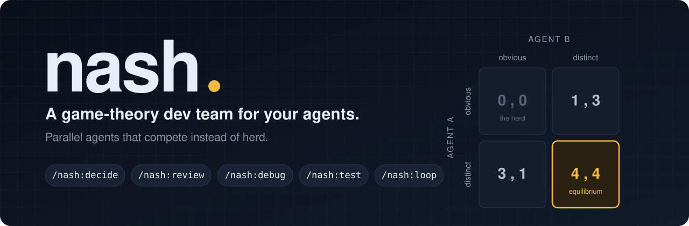
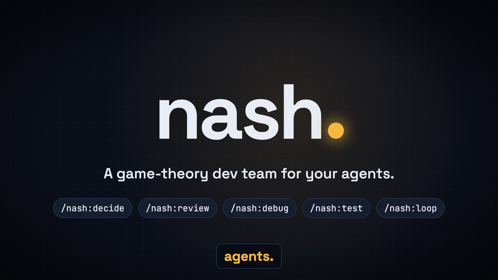
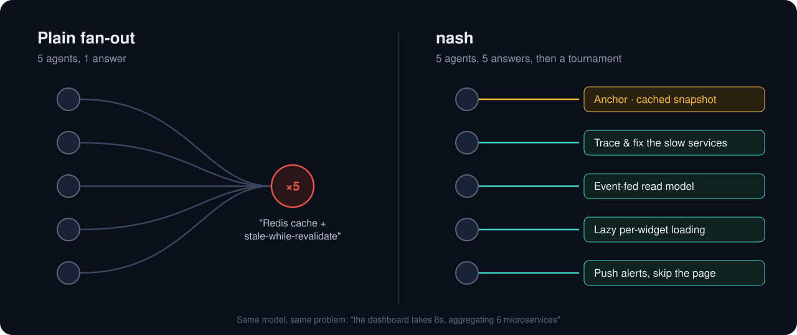
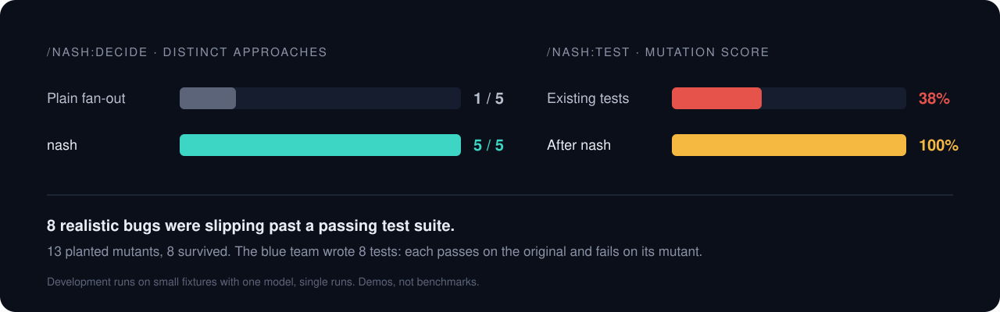

<p align="center"></p>

# nash

**A game-theory dev team, packaged as a Claude Code plugin.** Your agents stop agreeing and start competing.

Run parallel agents and they herd: same answer, same nitpicks, same blind spots, because they're copies of the same model. Nash fixes this with game theory. Every multi-agent job becomes a game whose rules make the herd's move a losing one.

<p align="center">
  <a href="assets/nash-demo.mp4"></a>
  <br>
  <a href="assets/nash-demo.mp4"><b>▶ Watch the 1-minute demo (with narration)</b></a> · <a href="https://github.com/prathameshfuke/nash/releases/latest">4K download</a>
</p>

| Command | Pain | The game |
|---|---|---|
| `/nash:decide` | 10 agents, one opinion | **Focal-point breaking:** banned levers per niche, then a blind tournament |
| `/nash:review` | AI reviews full of nitpicks and false alarms | **Bug bounty:** points only for *proven* bugs, and false alarms cost points |
| `/nash:debug` | The agent locks onto its first guess | **Hypothesis market:** competing theories, run the experiment that splits them, Brier-scored |
| `/nash:test` | Tests pass but catch nothing | **Mutant war:** red agents plant bugs, blue agents must kill them |
| `/nash:loop` | Builder–critic loops collude, thrash, or never stop | **Inspection game and optimal stopping:** fresh critics, random audits, frozen checks |

## Install

In Claude Code:

```
/plugin marketplace add prathameshfuke/nash
/plugin install nash@nash
```

## Why agents herd

Copies of the same model, given the same prompt, all aim for the same **Schelling focal point**. Research calls this the *Artificial Hivemind* ([Jiang et al., NeurIPS 2025](https://arxiv.org/abs/2510.22954)). Alignment training reduces output diversity further ([Kirk et al., ICLR 2024](https://arxiv.org/abs/2310.06452)). Personas don't fix it, because agents with different personas still share one reasoning method ([DMAD, ICLR 2025](https://proceedings.iclr.cc/paper_files/paper/2025/hash/3de667dab3b3d812583abc0a786139a0-Abstract-Conference.html)). Letting agents see each other makes it worse, through conformity and sycophancy ([Yao et al. 2025](https://arxiv.org/abs/2509.23055)).

Nash never hopes for diversity. It **assigns** it, and then it **pays** for it.

<p align="center"></p>

## Measured results

Every number below comes from runs during development: same model throughout, small fixtures, single runs. Read them as demos, not benchmarks.

<p align="center"></p>

**`/nash:decide`**: "the dashboard takes 8s, aggregating 6 microservices", 5 agents

| | Distinct approaches |
|---|---|
| Plain fan-out | **1 / 5**: all five said "Redis cache plus stale-while-revalidate" |
| nash | **5 / 5**: cache · trace and fix the slow services · event-fed read model · lazy widgets · push alerts |

The obvious answer still won the tournament. The difference is that it beat four real rivals, and the steal list added "trace before you cache".

**`/nash:test`**: a cart module with a passing but weak test suite

| | Mutation score |
|---|---|
| Existing tests | **5 / 13 (38%)**: 8 realistic bugs would have shipped |
| After the nash blue team | **13 / 13 (100%)**: 8 tests added, each verified to pass on the original and fail on its mutant |

**`/nash:review`**: the same module, with 4 planted bugs. A plain reviewer and the nash hunters both found all 4. Every nash finding came with a repro that was actually run. The plain review's 10 items included roughly half opinions ("use Decimal", "public mutable state"). The test also exposed a flaw: hunters ignored their assigned grounds and all reported the obvious bugs. Review now starts with a *focal sweep* that pre-claims the obvious bugs at zero points.

**`/nash:debug`** and **`/nash:loop`** were checked by a fresh agent walking through realistic scenarios (a flaky CI test; an iterated `slugify()`), and the gaps it found are fixed. Neither has a benchmark yet.

## How each game works

**decide:** Name the obvious answer first. You're the same model as the herd, so your first instinct *is* the focal point. One Anchor agent argues it. Every other agent has its levers banned, and bans apply to mechanisms, not words, so renaming a cache doesn't get around a cache ban. Agents play blind and in parallel, duplicates get re-rolled, and 3 judges score shuffled entries by Borda count. A top-2 final judged in both orders runs only if the judges split.

**review:** Sweep for the obvious bugs and mark them claimed. Each hunter gets one hunting ground and a posted bounty: +severity for a proven bug, −2×confidence×severity for a disproven one, 0 for style. The orchestrator re-runs every proof and sends adversarial verifiers after unproven claims. The report ends with a count of rejected false alarms.

**debug:** Each agent owns a cause class (recent change, state, environment, timing, wrong expectation, boundary) plus an OTHER slot, and prices its hypothesis. Run the cheapest experiment on which the probability-weighted hypotheses disagree, and kill or down-weight the losers. Fix only when one theory has survived an experiment that could have killed it. Flaky bugs are handled with failure rates over N runs.

**test:** Red agents plant minimal, realistic mutants, each with a differentiating input. Mutants are scored in an isolated copy. Blue agents kill the survivors, and tests are never allowed to lock in a bug that contradicts the spec.

**loop:** Freeze acceptance tests and numeric thresholds before round 1. Every round gets a fresh critic, and one secret round is audited with a planted defect. Thrash detection uses canonical issue IDs, the loop stops on diminishing returns, and the best snapshot ships, not the last one.

## Research

- Focal points in LLMs: [Aharon et al. 2026](https://arxiv.org/abs/2601.22184) · Schelling, *The Strategy of Conflict* (1960)
- Homogeneity: [Jiang et al. 2025](https://arxiv.org/abs/2510.22954) · [Kirk et al. 2023](https://arxiv.org/abs/2310.06452) · [Verbalized Sampling](https://arxiv.org/abs/2510.01171)
- Diverse reasoning and quality-diversity: [DMAD](https://proceedings.iclr.cc/paper_files/paper/2025/hash/3de667dab3b3d812583abc0a786139a0-Abstract-Conference.html) · [MAP-Elites](https://arxiv.org/abs/1504.04909) · [QDAIF](https://arxiv.org/abs/2310.13032)
- Debate vs. voting and conformity: [Du et al. 2023](https://arxiv.org/abs/2305.14325) · [Choi et al. 2025](https://arxiv.org/abs/2508.17536) · [Stop Overvaluing MAD](https://arxiv.org/abs/2502.08788) · [MAST](https://arxiv.org/abs/2503.13657)
- Judge bias: [Zheng et al. 2023](https://arxiv.org/abs/2306.05685) · [Wang et al. 2023](https://arxiv.org/abs/2305.17926) · [Panickssery et al. 2024](https://arxiv.org/abs/2404.13076)
- Mechanism design for LLMs: [Duetting et al. 2023](https://arxiv.org/abs/2310.10826) · [Consensus Game](https://arxiv.org/abs/2310.09139) · [AI Safety via Debate](https://arxiv.org/abs/1805.00899)
- Scoring rules: Brier (1950), *Verification of forecasts expressed in terms of probability* · Gneiting & Raftery (2007), *Strictly proper scoring rules*
- Mutation testing: DeMillo, Lipton & Sayward (1978), *Hints on test data selection*
- Inspection games: Avenhaus, von Stengel & Zamir (2002), *Handbook of Game Theory* vol. 3
- Optimal stopping: Ferguson (1989), *Who solved the secretary problem?*

## License

MIT
